# PA3 — Poucos rótulos: fauna em câmeras trap

**Matheus Pinto e Beatriz Marques** · Aprendizado Profundo (FGV), Prof. Dario Oliveira

Classificação de espécie (21 classes, ENA24) com **5 rótulos por classe** e
6.505 imagens sem rótulo. Métrica principal: **F1 macro** no `test_public`.
Ver `PA3.pdf` para o enunciado completo.

## Ambiente

```bash
python -m venv .venv
source .venv/bin/activate  # ou .venv\Scripts\activate no Windows
pip install -r requirements.txt
```

Python 3.13 (local; no Colab, a versão padrão dele); versões fixadas em
`requirements.txt`.
Desenvolvido em CPU (i5-1240P, 16 GB, PyTorch 2.14); os treinos pesados
rodaram no Colab (ver "Onde cada coisa rodou"). Os dados (`pa3_dados.zip`)
devem ser extraídos em `pa3_dados/pa3_dados/` (fora do git). O
`predict.py` só precisa de `torch`, `torchvision`, `numpy` e `Pillow`.

## Modelo entregue

| | |
|---|---|
| arquitetura | ResNet-18 (ImageNet → aluno da Trilha C, `soft_improved_mc_tau70`, orçamento 5, seed 0) |
| professor que gerou os rótulos | BioCLIP 2 melhorado com os 105 rótulos, 3 recortes da foto (F1 0,788) |
| parâmetros | **11.187.285** (limite: 12M) |
| pesos | `weights/modelo_final.pt` (44,8 MB; inclui nomes das classes e resolução 224×320) |
| F1 macro test_public | **0,620** (acurácia 0,658); média de 3 seeds: 0,655 ± 0,032 |
| tempo em CPU | 811 imagens em 17–50 s (i5-1240P); o test_private cabe com folga em 10 min |

**Este é o modelo que a regra escolheu, não o de maior F1 no teste.** A
regra, fixada antes, é: maior F1 macro no val entre as variantes do aluno
(orçamento 5, seed 0). Ela escolheu este aluno por 0,679 contra 0,677 do
aluno da versão anterior (`soft_improved_tau70`). A diferença é de uma
imagem do val, e no teste esse outro aluno tem 0,683. Não trocamos o modelo
olhando o teste. A Parte 1 explica por que essa diferença é ruído e o que
ela ensina.

**Um comando que treina** o modelo entregue do zero, a partir dos
pseudo-rótulos versionados em `outputs/part1/pseudo_labels/` (~5 min numa
GPU T4; ~1h10 em CPU):

```bash
python scripts/build_cache.py && python scripts/train_final.py
```

- Treina só o modelo entregue, com a mesma receita e a mesma seleção de
  época no val, e exporta para `weights/modelo_retreinado.pt`.
- Grava em pastas próprias (`outputs/final_retrain/`), então nunca
  sobrescreve os resultados versionados nem `weights/modelo_final.pt`. Para
  substituir os pesos entregues, use `--saida weights/modelo_final.pt`.
- Para refazer também os pseudo-rótulos, rode antes
  `python scripts/part1_teacher.py` e `python scripts/part1_teacher_multicrop.py`.

**Reprodutibilidade.** Toda tabela e figura deste README sai dos scripts a
partir dos resultados versionados em `outputs/`: JSONs e logits de teste de
cada rodada. **Retreinar** não dá exatamente os mesmos números, porque em GPU
o treino usa precisão mista, que não é determinística. A variação esperada é
da ordem do desvio entre seeds (±0,03 de F1 para o aluno, ver Parte 2).

**Um comando que avalia** (CPU, sem internet, imprime os parâmetros):

```bash
python predict.py --imagens pa3_dados/pa3_dados/images/test_public --saida preds.csv --rotulos pa3_dados/pa3_dados/labels/test_public.csv
```

Sem `--rotulos`, só escreve o CSV `image_id,label`, que é o formato pedido
para o test_private. Conferido: com `weights/modelo_final.pt`, o
`predict.py` dá o mesmo F1 (0,620) e acurácia (0,658) que o treino.

## Estrutura

```
pa3/
  config.py      # caminhos, classes, resolução de entrada (224x320), teto
  data.py        # CSVs de rótulo, cache de imagens, aumentação, detector de foto noturna
  models.py      # CNN pequena do zero e ResNet-18 ImageNet (contagem de parâmetros)
  engine.py      # laço de treino (seleção de época no val, rótulos suaves, checkpoint por época)
  metrics.py     # F1 macro, acurácia, F1 por classe, matriz de confusão
  floor.py       # receita do piso (Parte 0, reutilizada na Parte 2)
  teacher.py     # Trilha C: professor (BioCLIP/CLIP), prompts, recortes, professor melhorado
  student.py     # Trilha C: aluno ResNet-18 nos pseudo-rótulos (10 variantes)
  saliency.py    # Grad-CAM, oclusão e fração da atenção dentro do animal
  plotting.py    # estilo e matriz de confusão
scripts/
  build_cache.py               # pré-redimensiona as imagens uma vez (cache/)
  part0_floor.py               # Parte 0: o piso
  part1_teacher.py             # Parte 1: escolha e análise do professor (center crop) + pseudo-rótulos
  part1_megadetector.py        # Parte 1: caixas dos animais (só medição, não entra no modelo)
  part1_teacher_multicrop.py   # Parte 1: professor com 3 recortes + pseudo-rótulos dele
  part1_student.py             # Parte 1: alunos, comparação com professor e piso, escolha no val
  part1_size_analysis.py       # Parte 1: acerto por tamanho/posição do animal
  part1_cottontail.py          # Parte 1: por que o aluno erra os coelhos (atalho de câmera)
  part2_budget.py              # Parte 2: curva de orçamento
  part3_gallery.py             # Parte 3: galeria de erros e acertos com saliência
  export_model.py              # empacota um checkpoint do aluno para o predict.py
  train_final.py               # treina do zero só o modelo entregue
predict.py                     # modelo entregue: pasta de imagens -> CSV
colab/run_pa3.ipynb            # o mesmo pipeline em GPU no Colab
outputs/partN/                 # figuras e números de cada parte
outputs/floor_runs/            # cada rodada do piso (json + logits de teste)
outputs/part1/students/        # cada rodada do aluno (json + logits de teste)
outputs/part1/pseudo_labels/   # pseudo-rótulos de cada professor e orçamento
outputs/part1/teacher_embeddings/  # embeddings do BioCLIP 2 (dispensa o ViT-L para refazer)
curva_orcamento.csv            # entregável da Parte 2
AI_LOG.md                      # uso de IA no projeto
```

## Comandos

```bash
python scripts/build_cache.py               # uma vez (~2 min)
python scripts/part0_floor.py               # Parte 0 (~35 min em CPU)
python scripts/part1_teacher.py             # Parte 1: professor (~2 h em CPU na 1a vez; depois, segundos)
python scripts/part1_megadetector.py        # Parte 1: tamanho dos animais (requer ultralytics)
python scripts/part1_teacher_multicrop.py   # Parte 1: professor com 3 recortes (~15 min em GPU)
python scripts/part1_student.py             # Parte 1: 10 alunos e a escolha no val (GPU recomendada)
python scripts/part1_size_analysis.py       # Parte 1: tamanho e posição do animal
python scripts/part1_cottontail.py          # Parte 1: o atalho de câmera nos coelhos
python scripts/part2_budget.py              # Parte 2: curva de orçamento (GPU recomendada)
python scripts/export_model.py checkpoints/student/soft_improved_mc_tau70_b5_s0.pt  # pesos entregues
python scripts/part3_gallery.py             # Parte 3: galeria com saliência (usa weights/modelo_final.pt)
```

Tempos de treino medidos numa T4: cada aluno leva 4–7 min (os 10 somam
~1 h); cada piso, 1–3 min.

Todos os treinos salvam checkpoint a cada época: rodar o mesmo comando de
novo continua de onde parou, e rodadas já concluídas são recarregadas em vez
de retreinadas.

**Onde cada coisa rodou.** Parte 0 e o professor de center crop rodaram em
CPU, nesta máquina. Os alunos, o MegaDetector, os recortes laterais do
professor de 3 recortes e a Parte 2 rodaram no Colab (GPU T4) com
`colab/run_pa3.ipynb`, que clona este repositório, usa os embeddings e
pseudo-rótulos versionados e grava os resultados no Drive. Em CPU, cada
aluno levava ~1h20 (6,5k imagens × 12 épocas), e o projeto inteiro ficaria
em ~20 h só de treino. O código é o mesmo nos dois lugares (`pa3/config.py`
escolhe o device; em GPU o treino usa precisão mista).

## Decisões registradas

- **Trilha da Parte 1:** C (professor e aluno). O trabalho começou só com
  CPU, e nessa trilha a parte cara (o *foundation model*) é só inferência,
  feita uma vez; os embeddings e pseudo-rótulos ficam versionados. Os
  treinos dos alunos depois foram para o Colab, mas a escolha continua
  valendo: o BioCLIP 2 conhece as espécies, o que nenhum pré-treino
  auto-supervisionado em 6,5 mil fotos daria.
- **Backbone:** ResNet-18 ImageNet (11.187.285 parâmetros com a cabeça de 21
  classes, abaixo do limite de 12M). É o mesmo backbone do teto (0,686).
- **Entrada:** quadro inteiro redimensionado para 224×320 (altura×largura),
  sem center crop, para não cortar animais pequenos na borda.
- **Seleção de modelo:** só no `val` (F1 macro; empate pela perda de val). O
  `test_public` só é avaliado depois, para reportar. A regra foi mantida
  mesmo quando o teste mostrou que outro aluno era melhor (ver "Modelo
  entregue").
- **O professor nunca vê o `val`:** a escolha do professor (modelo, vista,
  recortes, prompts) e o ajuste do professor melhorado usam só os rótulos do
  orçamento, que são do `train`.

## Parte 0 — O piso

Supervisionado só com `rotulos_5.csv` (105 imagens), seed 0. Época escolhida
pelo F1 macro no val.

| versão | parâmetros | melhor época (val) | F1 val | **F1 macro test** | acurácia test |
|---|---|---|---|---|---|
| (a) CNN pequena do zero | 1.187.893 | 120 | 0,360 | **0,307** | 0,353 |
| (b) ResNet-18 ImageNet + fine-tuning | 11.187.285 | 13 | 0,424 | **0,460** | 0,485 |
| teto (monitor: ResNet-18, todos os rótulos do train) | | | | 0,686 | |

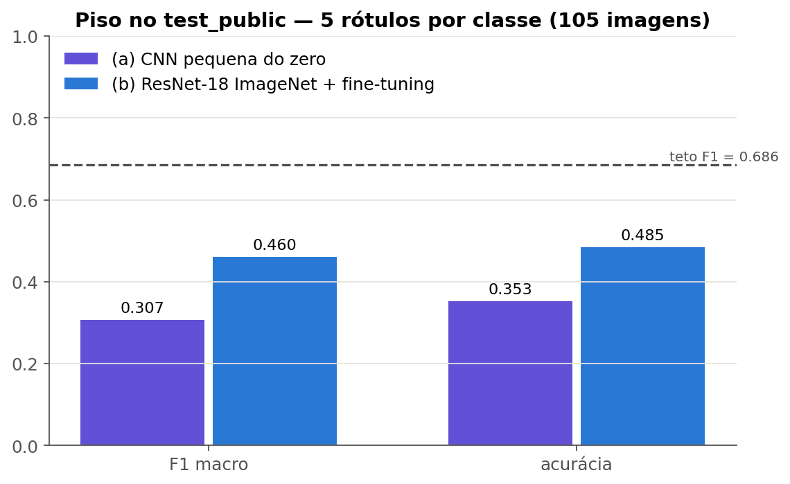

**Em que época começa a decorar?**

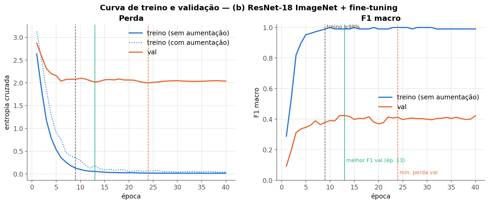

A ResNet-18 acerta ≥99% das 105 imagens de treino (sem aumentação) já na
**época 9**. A partir daí a perda de treino vai a ~0, enquanto o F1 de val fica
num platô de 0,37–0,42 e a perda de val mal se mexe (2,04 na época 6, mínimo
de 2,00 na época 24). A rede decora as 105 imagens em ~9 épocas, e todo
o treino seguinte só aumenta a confiança no treino, sem ganho real no val.

**Matriz de confusão da versão (b).** woodchuck já funciona como sumidouro
no piso (crow→woodchuck: 30), grey_fox vaza para coyote (15) e bobcat
acerta só 3 de 34.

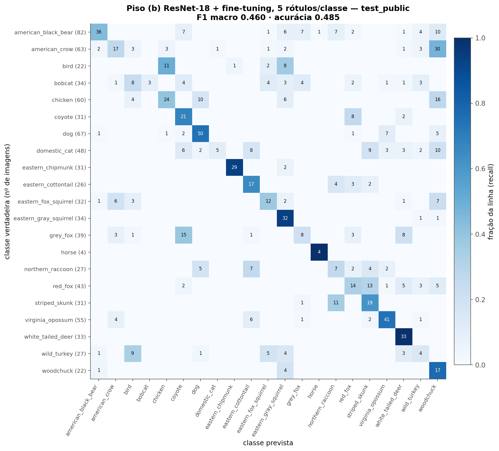

Outras figuras: [curva da CNN do zero](outputs/part0/03b_curva_small_cnn.png),
[F1 por classe](outputs/part0/04_f1_por_classe.png).

## Parte 1 — Trilha C: o professor

**Escolha do professor**, feita **só com os 105 rótulos do orçamento** (que
são do train). O val nunca é mostrado ao professor. O test_public aparece só
como referência.

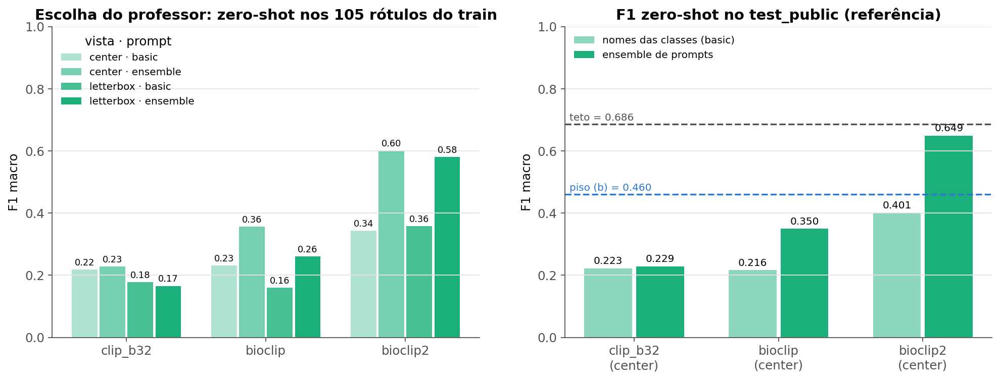

| professor (pesos abertos, rodando local) | F1 nos 105 rótulos (center · ensemble) | F1 zero-shot test_public: só nomes das classes | … ensemble de prompts |
|---|---|---|---|
| CLIP ViT-B/32 (OpenAI) | 0,23 | 0,223 | 0,229 |
| BioCLIP (ViT-B/16) | 0,36 | 0,216 | 0,350 |
| **BioCLIP 2 (ViT-L/14)** | **0,60** | **0,401** | **0,649** |

- A linha de referência obrigatória (nomes das classes como prompt) é **0,401**.
  Com o ensemble de prompts (nome comum + científico, "camera trap photo",
  "at night", "infrared") o mesmo modelo vai a **0,649**, acima do piso (0,460).
- **Center crop venceu letterbox** em todos os professores: a foto inteira com
  faixas cinza deixa o animal ainda menor nos 224 px do ViT.
- **Professor melhorado** com os rótulos do orçamento: protótipo de cada
  classe = `normalize(texto + β · média das imagens rotuladas)`, com β e a
  temperatura escolhidos por leave-one-out nos próprios rótulos.
- **Professor com 3 recortes** (`scripts/part1_teacher_multicrop.py`). O
  ViT recebe um quadrado; a foto é 4:3. O center crop perde 12,5% de cada
  lateral, e 117 imagens do teste (15%, medidas com o MegaDetector) têm mais
  da metade do animal ali. Aplicamos o mesmo professor melhorado (mesmos
  protótipos) a 3 quadrados: o central e os encostados em cada lateral. A
  forma de combinar foi escolhida nos 105 rótulos, por leave-one-out: só o
  centro 0,650, média das 3 vistas 0,734, **vista mais confiante 0,762**.

| orçamento | β (LOO) | professor melhorado, center crop: F1 test | **3 recortes (vista mais confiante): F1 test** |
|---|---|---|---|
| 1/classe | 1,0 (padrão: LOO impossível) | 0,671 | **0,719** |
| 5/classe | 0,25 | 0,682 | **0,788** |
| 20/classe | 1,0 | 0,738 | **0,854** |

Com 3 recortes, o professor passa o teto (0,686) sem nenhum treino, e o
acerto nas imagens com animal na borda vai de 26% para 68%. **Os
pseudo-rótulos dos alunos finais vêm dele.** Ele foi acrescentado depois da
primeira rodada de alunos (feita com o center crop). Essa história está na
seção do aluno.

**Onde o professor erra.** A matriz de confusão do professor zero-shot é a
matriz de ruído dos pseudo-rótulos sem nenhum ajuste:

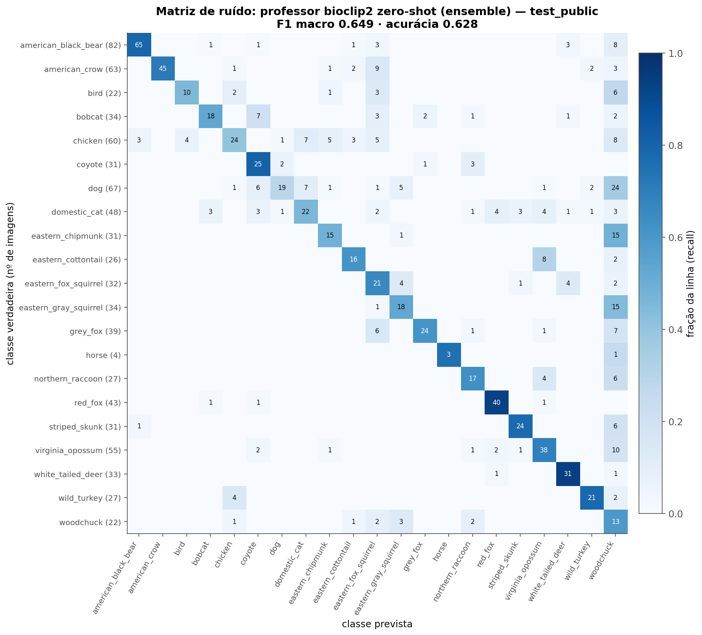

- **Woodchuck é uma classe-ímã.** O professor zero-shot prevê woodchuck 134
  vezes no test_public, onde só há 22 (acerta 13). Essas previsões têm
  confiança média 0,44 (contra 0,67 nas demais), e o texto "woodchuck" é o
  mais próximo do centróide de todas as imagens. Imagem com pouca evidência
  (animal pequeno, borrado) cai na classe mais "genérica". Os maiores
  vazamentos: dog→woodchuck (24), chipmunk→woodchuck (15), gray
  squirrel→woodchuck (15). O professor melhorado reduz os pseudo-rótulos de
  woodchuck no train de 835 para ~320:

  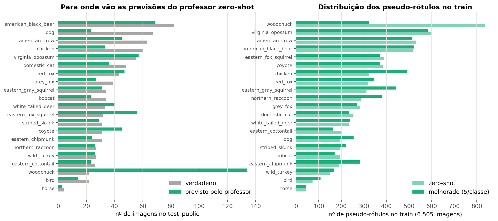
- **Noite não é o problema, é o contrário.**
  48% do test_public é noturno em IR (detectado pela diferença entre canais
  RGB, com separação limpa). O professor acerta 0,73 à noite e 0,54 de dia.
  Parte disso é a mistura de espécies (as diurnas, como passarinhos, esquilos
  e galinha, são mais difíceis), mas o efeito se mantém **dentro da mesma
  classe**: grey_fox 0,00→0,71, bird 0,27→0,86, dog 0,23→0,55. A exceção é
  domestic_cat (0,71→0,32). Hipótese: o flash IR ilumina o animal próximo e
  apaga o fundo. O piso não tem essa vantagem (0,49 dia, 0,48 noite).

  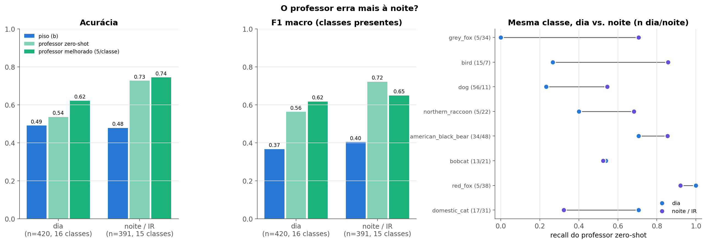
- **Classes parecidas:** crow→fox_squirrel (9), cottontail→opossum (8),
  bobcat→coyote (7). bird↔american_crow quase não se confundem no professor
  (0 e 0).
- **Precisão × cobertura** (diagnóstico no test_public, não seleção; professor
  melhorado de center crop): com τ=0,8 os pseudo-rótulos têm ~98% de
  precisão em ~45% das imagens. Com τ=0,5, ~88% em ~67%.

  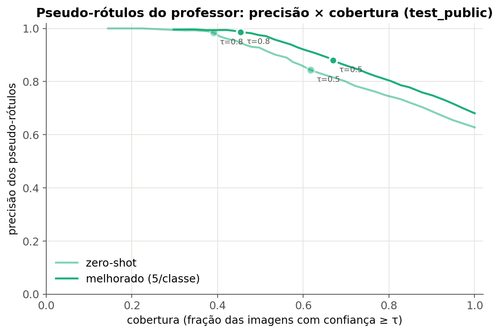

**A matriz de ruído do professor que de fato rotulou o train** (melhorado,
3 recortes). O woodchuck-ímã encolhe (134 previsões no zero-shot, 65 no
melhorado de center crop, 44 aqui), mas não some: gray squirrel→woodchuck
(14) é a maior confusão, empatada com dog→domestic_cat (14). Depois vem
domestic_cat→red_fox (8). bird↔american_crow continua quase limpo (4
corvos viram bird).

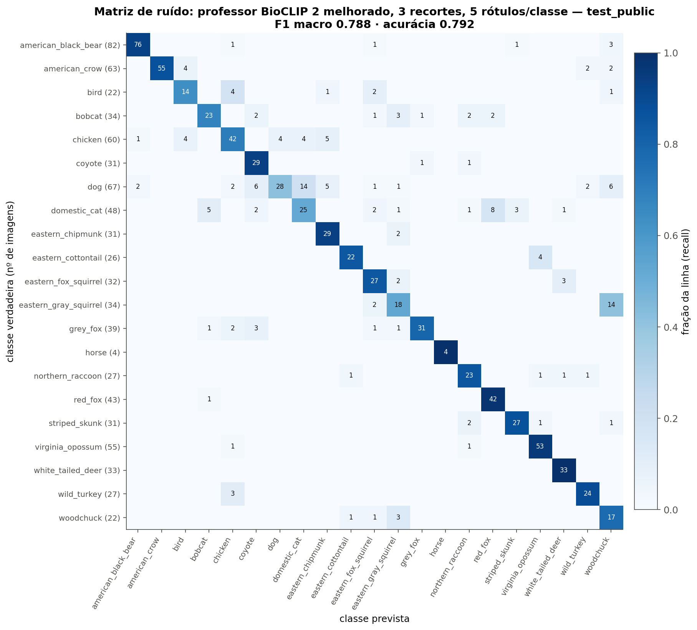

A matriz do professor melhorado de center crop, que rotulou a primeira
rodada de alunos, está em
[03_matriz_ruido_teacher_improved_b5.png](outputs/part1/03_matriz_ruido_teacher_improved_b5.png).

## Parte 1 — Trilha C: o aluno

O aluno é uma ResNet-18 ImageNet treinada em **todo o train** (6.505 imagens)
com os pseudo-rótulos do professor, mais os 105 rótulos verdadeiros com peso 5.
Formas de tratar o ruído, todas com a mesma receita (12 épocas, época
escolhida no val), seed 0, orçamento 5. As 6 primeiras usam o professor de
center crop (primeira rodada); as 4 últimas, o de 3 recortes:

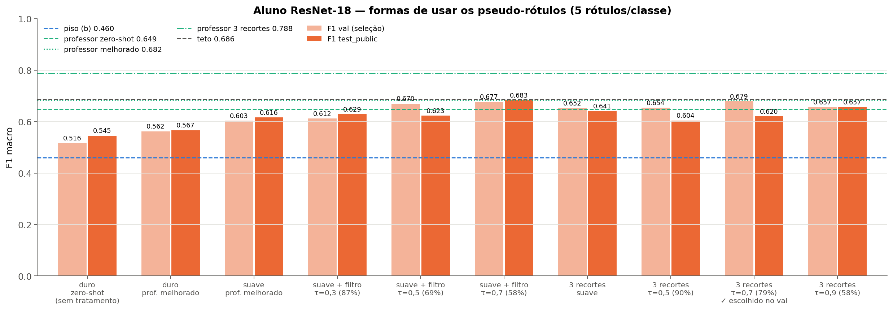

| professor | variante | imagens usadas | F1 val | F1 test | acurácia test |
|---|---|---|---|---|---|
| zero-shot | duro (argmax, sem tratamento) | 6.505 | 0,516 | 0,545 | 0,565 |
| melhorado, center crop | duro | 6.505 | 0,562 | 0,567 | 0,587 |
| melhorado, center crop | suave (distribuição do professor) | 6.505 | 0,603 | 0,616 | 0,656 |
| melhorado, center crop | suave + filtro τ=0,3 | 5.640 | 0,612 | 0,629 | 0,673 |
| melhorado, center crop | suave + filtro τ=0,5 | 4.483 | 0,670 | 0,623 | 0,647 |
| melhorado, center crop | suave + filtro τ=0,7 | 3.745 | 0,677 | **0,683** | **0,736** |
| 3 recortes | suave | 6.505 | 0,652 | 0,641 | 0,697 |
| 3 recortes | suave + filtro τ=0,5 | 5.886 | 0,654 | 0,604 | 0,658 |
| 3 recortes | **suave + filtro τ=0,7 (escolhido no val)** | 5.113 | **0,679** | 0,620 | 0,658 |
| 3 recortes | suave + filtro τ=0,9 | 3.764 | 0,657 | 0,657 | 0,716 |

**Com o professor de center crop**, cada tratamento do ruído soma ganho:
professor melhorado (+0,02), rótulo suave em vez de argmax (+0,05),
descartar os 42% menos confiáveis (+0,07). Jogar fora quase metade dos dados
ajudou, porque os pseudo-rótulos de baixa confiança são justamente os
errados (`06_precisao_cobertura.png`).

**Com o professor de 3 recortes, o aluno não melhorou.** O professor subiu
0,106 de F1 (0,682 → 0,788), e o melhor aluno de cada família ficou no
mesmo lugar:

| aluno, orçamento 5 | F1 val (3 seeds) | F1 test (3 seeds) |
|---|---|---|
| professor de center crop, τ=0,7 | 0,677 · 0,670 · 0,684 (média 0,677) | 0,668 ± 0,020 |
| professor de 3 recortes, τ=0,7 | 0,679 · 0,655 · 0,671 (média 0,668) | 0,655 ± 0,032 |

- **O gargalo deixou de ser o professor.** Os dois alunos ficam em torno de
  0,66, logo abaixo do teto (0,686): uma ResNet-18 treinada com **todos** os
  rótulos verdadeiros do train. Um professor melhor não ajuda um aluno que
  já está perto do que essa arquitetura, com essa entrada, consegue aprender
  destas 6,5 mil fotos. O próximo ganho viria do aluno (mais resolução,
  outro backbone dentro de 12M, ou um aluno que imite o professor também nos
  recortes), não do professor.
- **A escolha entre os dois foi ruído.** Com 202 imagens de val, 0,002 de
  F1 é uma imagem. A variação entre seeds do mesmo aluno (0,03 no teste) é
  maior que a diferença entre os dois alunos. A regra pegou o novo; a média
  de 3 seeds teria pegado o antigo; nenhuma das duas escolhas é
  estatisticamente distinguível no val. Mantivemos a regra fixada antes
  (seed 0) em vez de trocá-la depois de ver o teste.
- **O mesmo τ filtra menos com o professor novo.** Ele é mais confiante
  (usa a vista mais confiante): τ=0,7 mantém 79% das imagens, contra 58%
  com o center crop. O τ=0,9 mantém 58%, a mesma fração do τ=0,7 antigo, e
  ficou em 0,657 no teste.

Matriz de confusão do aluno entregue:

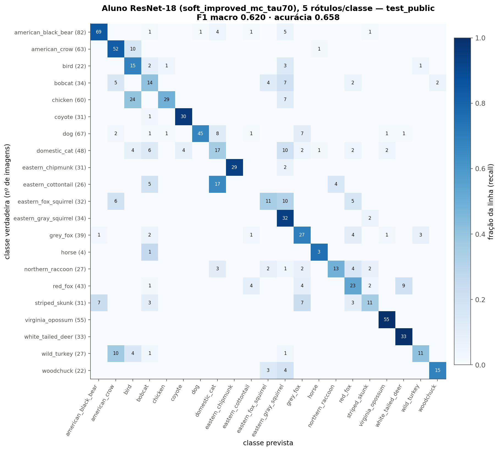

### Onde o aluno supera o professor, e por quê

Contra o professor de 3 recortes, o aluno ganha só em 5 classes: woodchuck
(+0,25), dog (+0,23), chipmunk (+0,15), coyote (+0,13) e opossum (+0,04).
Perde no resto, e muito no coelho:

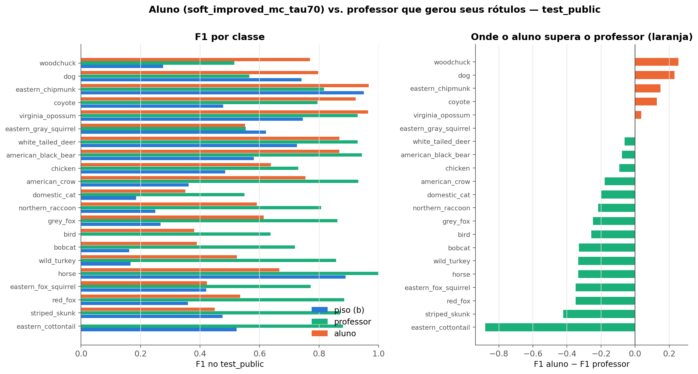

As mesmas caixas do MegaDetector explicam a mudança em relação à primeira
rodada:

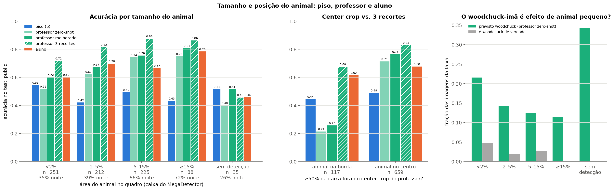

1. **A vantagem de "ver o quadro inteiro" era do professor de center crop.**
   Nas 117 imagens com animal na borda, o professor de center crop acerta
   26% e o aluno, 62%. O de 3 recortes acerta 68%. A entrada 224×320 sem crop
   (decidida na Parte 0) continua valendo para o aluno, mas deixou de ser
   uma vantagem sobre o professor, porque o professor passou a olhar as
   laterais.
2. **Ele herda a parte limpa do professor, não os vícios.** O
   woodchuck-ímã não passa para o aluno: o professor de 3 recortes prevê
   woodchuck 44 vezes (são 22 de verdade), e o aluno, 17. O filtro τ=0,7
   descarta 38% dos pseudo-rótulos de woodchuck (mantém 147 de 238), que são
   os de baixa confiança. Daí os ganhos em woodchuck, dog e chipmunk, as
   classes que vazavam para woodchuck.
3. **Ele aprende a cena, e isso agora pesa mais contra do que a favor.**
   Câmeras trap são fixas, e o aluno, treinado em 6,5 mil fotos dessas
   mesmas câmeras, usa o contexto. Por tamanho do animal, o aluno fica abaixo
   do professor de 3 recortes em todas as faixas (<2% do quadro: 0,60 contra
   0,72; ≥15%: 0,78 contra 0,86), e empata quando o MegaDetector não
   encontra animal (0,46 nos dois). Na primeira rodada, o aluno superava o
   professor de center crop nos animais minúsculos. Contra um professor que
   vê a foto toda, a cena não basta.

### Onde ele perde: o mesmo atalho, do outro lado

O aluno perde para o professor em eastern_cottontail (−0,88), striped_skunk
(−0,42), red_fox e fox_squirrel (−0,35). **O coelho é o caso mais claro de
atalho de câmera** (`scripts/part1_cottontail.py`):

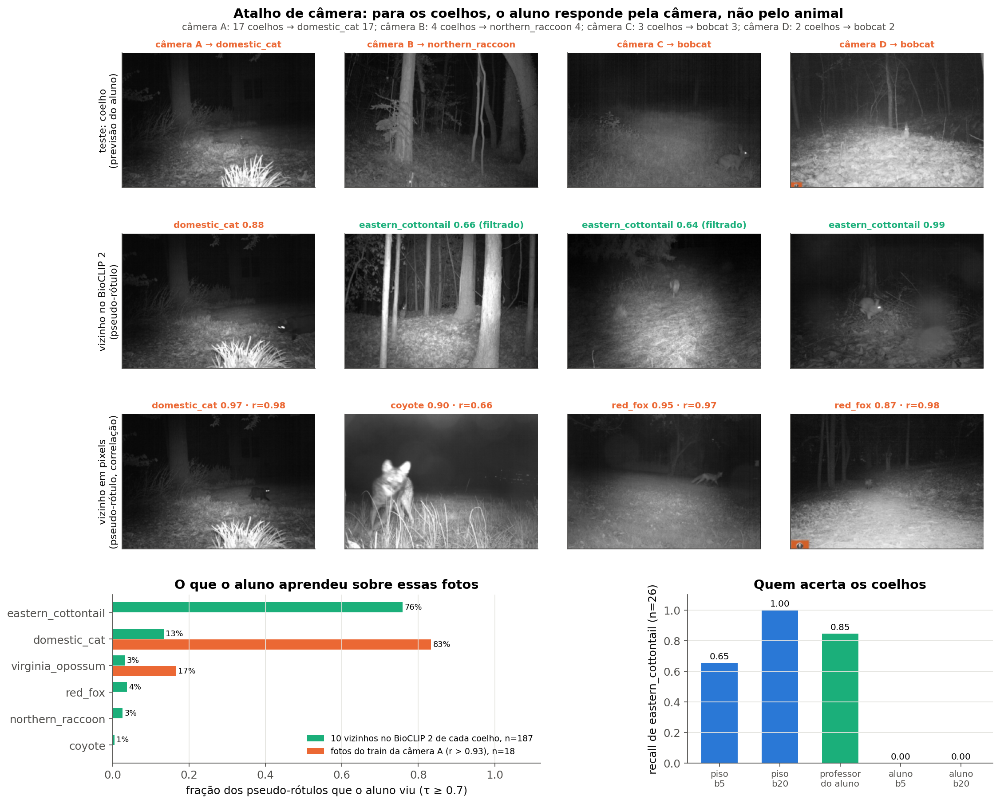

- Os 26 coelhos do test_public são todos noturnos e vêm de **4 câmeras**
  (agrupadas pela correlação dos pixels, que mede o fundo). **O aluno não
  acerta nenhum**, e o professor acerta 85%.
- **Dentro de cada câmera, a resposta é sempre a mesma**:
  - câmera A: 17 coelhos, **os 17 viram gato**;
  - câmera B: 4 coelhos, **os 4 viram guaxinim**;
  - câmera C: 3 coelhos, os 3 viram bobcat;
  - câmera D: 2 coelhos, os 2 viram bobcat.
- **Os pseudo-rótulos dos coelhos não são o problema.** No espaço do
  BioCLIP 2, os 10 vizinhos de cada coelho do teste no train são em grande
  parte coelhos: dos que o aluno viu (filtro τ=0,7), 142 de 187 (76%).
- **O problema é o que o aluno viu de cada câmera.**
  - A câmera A aparece 23 vezes no train (correlação de pixels > 0,93), e
    nenhuma dessas fotos é de coelho: das que o aluno viu, 15 são gato e 3,
    gambá-de-cauda-preênsil.
  - Nas câmeras C e D, a resposta "bobcat" coincide com os **rótulos
    verdadeiros do orçamento** dessas câmeras, que entram com peso 5: dois
    dos 4 rótulos da câmera C e três dos 8 da câmera D são bobcat.
  - A câmera B não aparece no train por essa medida, então o "guaxinim"
    dela fica sem explicação aqui.
- O coelho da câmera A tem cerca de 16×15 px. Para uma CNN, "esta câmera à
  noite" pesa mais que essa mancha.
- O piso b20 acerta os 26, **mas não por conhecer a câmera**: nenhum dos seus
  420 rótulos é dessas câmeras. Ele prevê coelho em excesso (66 vezes no
  teste, com 40 erros), e por isso o F1 dele no coelho fica em 0,57. O aluno
  b20 também erra os 26.

O BioCLIP olha para o animal; o aluno olha para a foto. Isso ajuda quando o
animal é ambíguo e a câmera é típica, e quebra em bloco quando uma câmera
recebe um animal que ela "não costuma ter". O mesmo coelho reaparece como
erro na Parte 3.

**bird, chicken e american_crow: efeito colateral do filtro de confiança.**

- O filtro τ=0,7 não corta igual em todas as classes. Ele mantém **95% dos
  pseudo-rótulos de corvo** (656 imagens), mas só **67% dos de bird** (57),
  justamente uma classe em que o professor hesita.
- Depois do filtro, o aluno vê 11 corvos para cada passarinho, e as aves
  passam a se misturar no aluno de um jeito que não acontece no professor:
  - 10 corvos viram bird, contra 4 no professor. Bird e american_crow são
    o par de classes parecidas que o enunciado cita;
  - **24 galinhas viram bird** (o professor: 4). É a maior confusão do
    aluno entregue;
  - 10 perus viram corvo.
- É o viés de classe que o filtro global cria: classe difícil fica magra no
  treino. A correção natural seria um **limiar por classe**, como no FlexMatch:
  mais baixo para classes em que o professor é menos confiante. Não
  testamos.

**Dia e noite:** o aluno fica parecido nos dois (acurácia 0,655 de dia,
0,662 à noite). O professor de 3 recortes vai a 0,736 de dia e 0,852 à
noite. A diferença maior é à noite, onde estão os 26 coelhos.

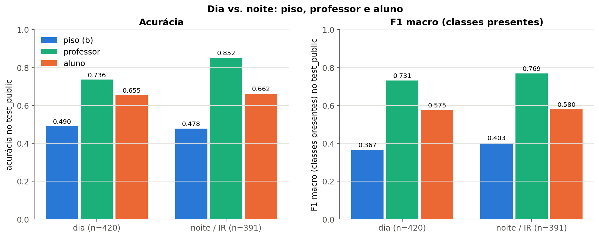

**Pergunta da apresentação: e se aparecer uma capivara?** O aluno tem 21
saídas e vai sempre escolher uma delas. Três sinais para detectar o
fora-de-distribuição, todos sem rótulo:

- **Confiança baixa do aluno:** softmax máximo ou energia. Como o aluno erra
  com confiança alta em cenas conhecidas (o coelho, a 0,93), esse sinal
  sozinho não basta.
- **Discordância professor × aluno.**
- **Distância do embedding do BioCLIP ao protótipo mais próximo.**

O BioCLIP 2 é de vocabulário aberto, então basta acrescentar o texto
"capybara" ao classificador do professor, sem treino, para nomear a classe nova
e gerar pseudo-rótulos para ela.

## Parte 2 — Curva de orçamento

Mesma receita do piso (b) e do aluno escolhido (`soft_improved_mc_tau70`)
com 1, 5 e 20 rótulos por classe; o professor de 3 recortes refaz os
pseudo-rótulos em cada orçamento (com o β do orçamento). Nos orçamentos 5 e
20 foram 3 seeds; a seed muda a inicialização da cabeça, a ordem dos lotes e
a aumentação, e os rótulos são os mesmos. Números em `curva_orcamento.csv`.

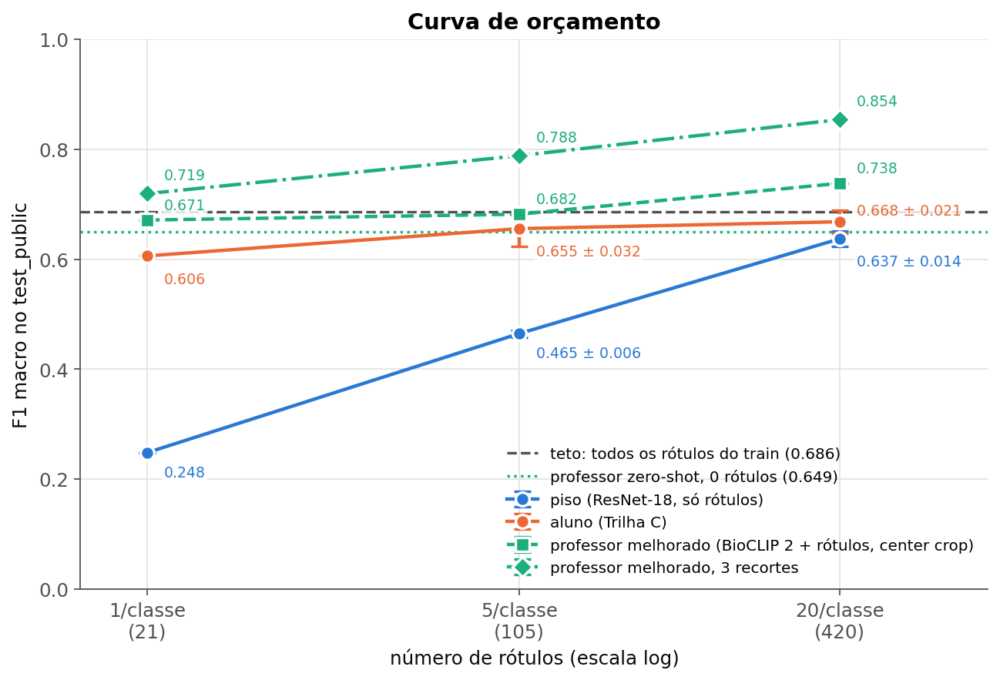

| método | 1/classe | 5/classe (3 seeds) | 20/classe (3 seeds) |
|---|---|---|---|
| piso (ResNet-18, só rótulos) | 0,248 | 0,465 ± 0,006 | 0,637 ± 0,014 |
| **aluno (Trilha C)** | **0,606** | **0,655 ± 0,032** | **0,668 ± 0,021** |
| professor melhorado, 3 recortes (referência) | 0,719 | 0,788 | 0,854 |
| professor melhorado, center crop (referência) | 0,671 | 0,682 | 0,738 |
| professor zero-shot (0 rótulos) | 0,649 | 0,649 | 0,649 |
| teto (todos os rótulos) | | 0,686 | |

- **Com 1 rótulo por classe, o aluno (0,606) faz mais que o piso com 5
  (0,465).** Os dados sem rótulo valem mais que 4 rótulos por classe.
- **Com 5, o aluno ganha +0,19 do piso** (3 seeds; desvios de 0,03 e 0,01
  contra uma diferença de 0,19).
- **Com 20, a vantagem cai para +0,03** (0,668 ± 0,021 contra 0,637 ± 0,014),
  da ordem do desvio entre seeds. O piso sobe 0,17 de 5 para 20 rótulos;
  o aluno, 0,01.
- **O aluno satura, o professor não.** De 1 para 20 rótulos, o aluno vai de
  0,606 a 0,668 e encosta no teto da ResNet-18 (0,686). O professor de 3
  recortes vai de 0,719 a 0,854. A distância entre os dois cresce com o
  orçamento: 0,11, 0,13 e 0,19. É a mesma conclusão da Parte 1, vista de
  outro ângulo: com mais rótulos o professor fica melhor, e o aluno não
  consegue acompanhar.
- O coelho continua em zero no aluno com 20 rótulos, enquanto o piso b20
  acerta os 26 (Parte 1).

**Ganho por classe com 5 rótulos** (média de 3 seeds):

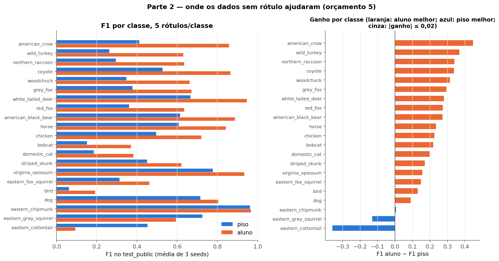

O aluno ganha em 19 das 21 classes. Os maiores ganhos estão nas classes que
o piso mal reconhecia: american_crow (+0,45), wild_turkey (+0,37), raccoon
(+0,34), coyote (+0,34), woodchuck (+0,31). As perdas são eastern_cottontail
(−0,36), o atalho de câmera descrito acima, e eastern_gray_squirrel (−0,13).

## Parte 3 — Erros e acertos com mapas de saliência

Modelo final no test_public. Dois mapas por imagem: **Grad-CAM** na `layer4`
(grosso, 7×10 células de 32 px) e **oclusão** (quadrado de 32 px tapado com
passo 16; mede quanto a probabilidade cai). A caixa verde é do MegaDetector,
usada só para medir quanto da saliência cai no animal. As 8 imagens foram
escolhidas **por regras fixadas antes de olhar** (`scripts/part3_gallery.py`),
não a dedo:

- erro mais confiante;
- erro com o menor animal;
- erro com animal ≥3% do quadro e a menor atenção no animal;
- para os acertos, os 3 mais focados no animal e os 2 menos focados, de
  classes diferentes e com animal ≥2%.

### Três erros

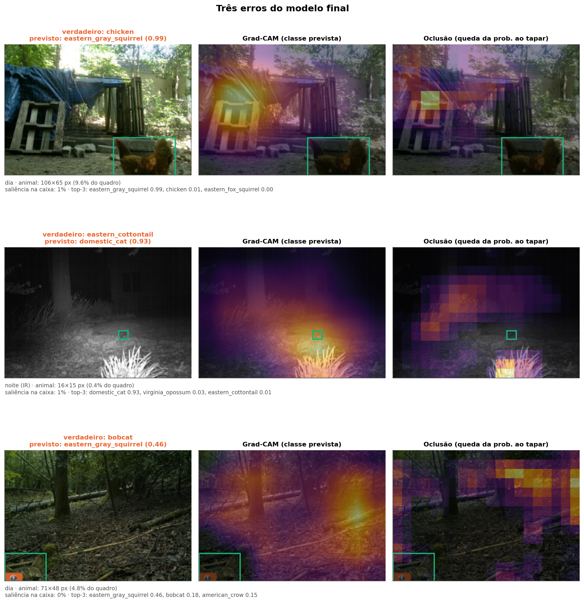

| # | verdadeiro → previsto | o que os mapas mostram | diagnóstico |
|---|---|---|---|
| E1 | chicken → eastern_gray_squirrel (0,99) | Galinha grande e nítida (9,6% do quadro) no canto inferior direito. Grad-CAM no palete e na lona do outro lado; **1% da saliência no animal**. | **Nem olhou para a galinha, e estava quase certo.** É o erro mais confiante do modelo. A decisão vem do quintal (palete, lona, cerca). Nossa leitura, não medida: esse cenário de quintal aparece no treino com esquilos. |
| E2 | eastern_cottontail → domestic_cat (0,93) | Coelho de 16×15 px (0,4% do quadro). Grad-CAM no tufo de capim; **1% da saliência no animal**. A oclusão espalha-se pelo fundo. | **Atalho de câmera**, o mesmo da Parte 1. É a câmera A: no train ela só aparece com gatos e gambás-de-cauda-preênsil, e o modelo reconhece o lugar, não o bicho. Tapar o coelho não muda nada. |
| E3 | bobcat → eastern_gray_squirrel (0,46) | Bobcat **cortado no canto** inferior esquerdo. Grad-CAM **0%** na caixa, concentrado no meio da floresta. | **Nem olhou para o animal.** Um animal entrando pela borda é raro no treino, e o modelo decidiu pelo cenário, com baixa confiança (bobcat em 2º, 0,18). |

### Cinco acertos

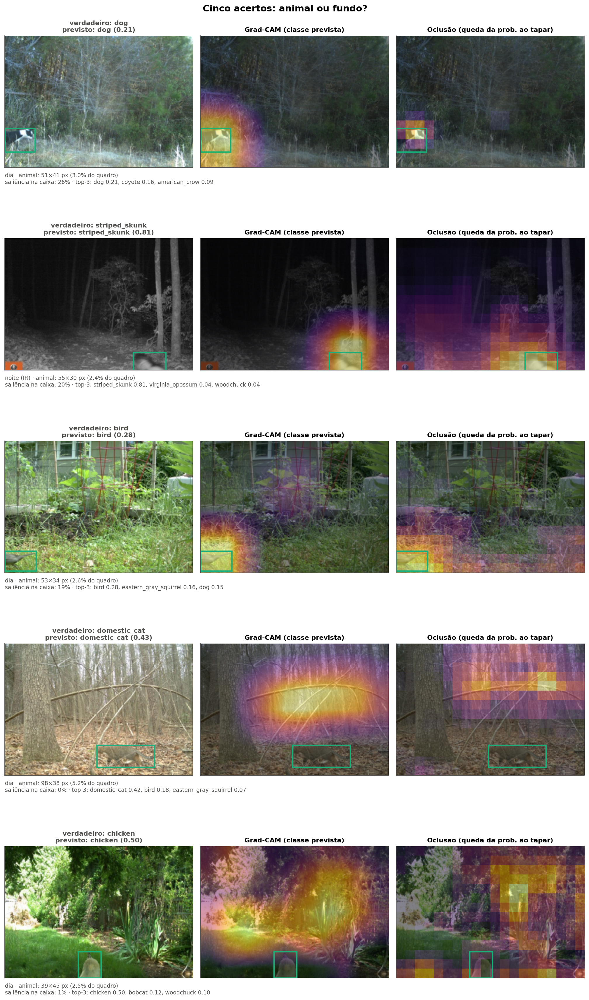

| # | classe | atenção no animal | leitura |
|---|---|---|---|
| A1 | dog (0,21) | 26% numa caixa de 3,0% (9× o acaso); o pico do Grad-CAM e a oclusão caem no cão. | Certo pelo motivo certo, com animal pequeno e na borda, mas com confiança baixa (coyote em 2º, 0,16). |
| A2 | striped_skunk (0,81) | 20% numa caixa de 2,4%, à noite. Os dois mapas centrados no gambá. | Certo pelo motivo certo. |
| A3 | bird (0,28) | 19% numa caixa de 2,6%, na borda esquerda. | Certo pelo motivo certo, com o passarinho cortado na borda: o que o center crop perderia. Confiança baixa. |
| A4 | domestic_cat (0,43) | **0%**. Grad-CAM e oclusão nos galhos do meio da foto. | **Certo pelo motivo errado.** O gato está nítido no chão, e o modelo responde pelo cenário. |
| A5 | chicken (0,50) | **1%**. Atenção espalhada pela vegetação. | Mesmo caso: acerto pela cena. Hipótese, não testada: a mesma galinha em outra câmera não seria reconhecida, como o coelho da Parte 1. |

### Olha para o animal ou para o fundo? (agregado, 776 imagens com caixa)

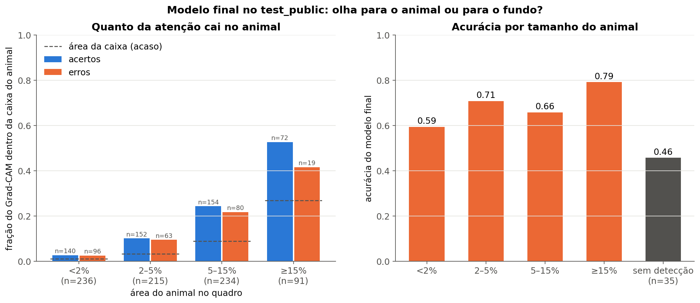

A pergunta tem resposta quantitativa: a
fração do Grad-CAM dentro da caixa, comparada com a área da caixa (o que
daria uma atenção uniforme).

| área do animal | atenção no animal (acertos) | (erros) | área da caixa (acaso) | pico do mapa no animal (acertos / erros) |
|---|---|---|---|---|
| <2% | 2,7% | 2,5% | ~1% | 11% / 7% |
| 2–5% | 10% | 10% | ~3% | 45% / 24% |
| 5–15% | 24% | 22% | ~9% | 76% / 48% |
| ≥15% | 53% | 42% | ~27% | 79% / 58% |

- **Animal grande: o modelo olha para o animal.** A atenção fica em ~2× o
  acaso, e o pico do mapa cai no animal em 76–79% dos acertos.
- **Animal pequeno: olha para o fundo.** Abaixo de 2% do quadro (30% das
  imagens), a atenção no animal é praticamente o acaso, e o pico só cai nele
  em 11% dos casos. **Mesmo assim, o modelo acerta 59% dessas imagens**: a
  decisão vem da cena.
- **Acertos olham mais para o animal que erros.** No pointing game: 50%
  contra 28% no geral, e a diferença aparece em todas as faixas.

**Conclusão.** Com animal visível, o modelo aprendeu o animal. Com animal
pequeno, ele aprendeu *qual câmera costuma ter qual bicho*. Esse hábito
explica por que ele acerta mais da metade das fotos em que o animal é uma
mancha, e por que falha em bloco quando uma câmera recebe um visitante raro
(o coelho). Também explica o teto da Parte 1: um aluno que decide pela cena
não aproveita um professor que melhorou justamente em olhar para o animal.

**O que isso significa para o test_private.** Pelo enunciado, o split
separa câmera-noite, mas a mesma câmera pode aparecer em conjuntos diferentes
em noites diferentes. O test_private provavelmente repete câmeras do train,
como o test_public, então o atalho deve continuar ajudando mais do que
atrapalha, e esperamos um F1 parecido com o do test_public (com a variação
de ±0,03 que vimos entre seeds). Numa câmera nova (como a do Uruguai da
pergunta da capivara), o desempenho nos animais pequenos deve cair bastante.
Seria a primeira coisa a medir com mais tempo, por exemplo deixando câmeras
inteiras de fora na validação.
