# PA3 — Poucos rótulos: fauna em câmeras trap

Classificação de espécie (21 classes, ENA24) com **5 rótulos por classe** e
6.505 imagens sem rótulo. Métrica principal: **F1 macro** no `test_public`.
Ver `PA3.pdf` para o enunciado completo.

## Ambiente

```bash
python -m venv .venv
source .venv/bin/activate  # ou .venv\Scripts\activate no Windows
pip install -r requirements.txt
```

Desenvolvido em CPU (i5-1240P, 16 GB, PyTorch 2.14); os treinos pesados
rodaram no Colab (ver "Onde cada coisa rodou"). Os dados (`pa3_dados.zip`)
devem ser extraídos em `pa3_dados/pa3_dados/` (fora do git).

## Modelo entregue

| | |
|---|---|
| arquitetura | ResNet-18 (ImageNet → aluno da Trilha C, `soft_improved_tau70`, orçamento 5, seed 0) |
| parâmetros | **11.187.285** (limite: 12M) |
| pesos | `weights/modelo_final.pt` (44,8 MB; inclui nomes das classes e resolução 224×320) |
| F1 macro test_public | **0,683** (acurácia 0,736) |
| tempo em CPU | 811 imagens em 17–50 s (i5-1240P); o test_private cabe com folga em 10 min |

**Um comando que treina** (a partir dos pseudo-rótulos versionados em
`outputs/part1/pseudo_labels/`; GPU recomendada, ~10 min numa T4, ~1h20 em CPU):

```bash
python scripts/build_cache.py && python scripts/part1_student.py && python scripts/export_model.py checkpoints/student/soft_improved_tau70_b5_s0.pt
```

(Para refazer também os pseudo-rótulos, rode antes `python scripts/part1_teacher.py`.)

**Um comando que avalia** (CPU, sem internet, imprime os parâmetros):

```bash
python predict.py --imagens pa3_dados/pa3_dados/images/test_public --saida preds.csv --rotulos pa3_dados/pa3_dados/labels/test_public.csv
```

Sem `--rotulos`, só escreve o CSV `image_id,label`, que é o formato pedido
para o test_private.

## Estrutura

```
pa3/
  config.py      # caminhos, classes, resolução de entrada (224x320), teto
  data.py        # CSVs de rótulo, cache de imagens, aumentação, detector de foto noturna
  models.py      # CNN pequena do zero e ResNet-18 ImageNet (contagem de parâmetros)
  engine.py      # laço de treino (seleção de época no val, rótulos suaves, checkpoint por época)
  metrics.py     # F1 macro, acurácia, F1 por classe, matriz de confusão
  floor.py       # receita do piso (Parte 0, reutilizada na Parte 2)
  teacher.py     # Trilha C: professor (BioCLIP/CLIP), prompts, professor melhorado
  student.py     # Trilha C: aluno ResNet-18 nos pseudo-rótulos (6 variantes)
  saliency.py    # Grad-CAM, oclusão e fração da atenção dentro do animal
  plotting.py    # estilo e matriz de confusão
scripts/
  build_cache.py            # pré-redimensiona as imagens uma vez (cache/)
  part0_floor.py            # Parte 0: o piso
  part1_teacher.py          # Parte 1: escolha e análise do professor + pseudo-rótulos
  part1_megadetector.py     # Parte 1: caixas dos animais (só medição, não entra no modelo)
  part1_student.py          # Parte 1: alunos, comparação com professor e piso
  part1_size_analysis.py    # Parte 1: acerto por tamanho/posição do animal
  part1_cottontail.py       # Parte 1: por que o aluno erra os coelhos (atalho de câmera)
  part2_budget.py           # Parte 2: curva de orçamento
  part3_gallery.py          # Parte 3: galeria de erros e acertos com saliência
  export_model.py           # empacota o aluno escolhido em weights/modelo_final.pt
predict.py                  # modelo entregue: pasta de imagens -> CSV
colab/run_pa3.ipynb         # o mesmo pipeline em GPU no Colab
outputs/partN/              # figuras e números de cada parte
outputs/floor_runs/         # cada rodada do piso (json + logits de teste)
outputs/part1/students/     # cada rodada do aluno (json + logits de teste)
curva_orcamento.csv         # entregável da Parte 2
AI_LOG.md                   # uso de IA no projeto
```

## Comandos

```bash
python scripts/build_cache.py         # uma vez (~2 min)
python scripts/part0_floor.py         # Parte 0 (~35 min em CPU)
python scripts/part1_teacher.py       # Parte 1: professor (~2 h em CPU na 1a vez; depois, segundos)
python scripts/part1_megadetector.py  # Parte 1: tamanho dos animais (requer ultralytics)
python scripts/part1_student.py       # Parte 1: 6 alunos (GPU recomendada)
python scripts/part1_size_analysis.py # Parte 1: tamanho e posição do animal
python scripts/part1_cottontail.py    # Parte 1: o atalho de câmera nos coelhos
python scripts/part2_budget.py        # Parte 2: curva de orçamento (GPU recomendada)
```

Todos os treinos salvam checkpoint a cada época: rodar o mesmo comando de
novo continua de onde parou, e rodadas já concluídas são recarregadas em vez
de retreinadas.

**Onde cada coisa rodou.** Parte 0 e o professor rodaram em CPU, nesta
máquina. Os alunos, o MegaDetector e a Parte 2 rodaram no Colab (GPU T4) com
`colab/run_pa3.ipynb`, que clona este repositório, usa os pseudo-rótulos
versionados em `outputs/part1/pseudo_labels/` e grava os resultados no Drive.
Em CPU, cada aluno levava ~1h20 (6,5k imagens × 12 épocas), e o projeto
inteiro ficaria em ~11 h só de treino. O código é o mesmo nos dois lugares
(`pa3/config.py` escolhe o device; em GPU o treino usa precisão mista).

## Decisões registradas

- **Trilha da Parte 1:** C (professor e aluno). Sem GPU, é a única trilha em
  que a parte cara (o *foundation model*) é só inferência, feita uma vez.
- **Backbone:** ResNet-18 ImageNet (11.187.285 parâmetros com a cabeça de 21
  classes, abaixo do limite de 12M). É o mesmo backbone do teto (0,686).
- **Entrada:** quadro inteiro redimensionado para 224×320 (altura×largura),
  sem center crop, para não cortar animais pequenos na borda.
- **Seleção de modelo:** só no `val` (F1 macro; empate pela perda de val). O
  `test_public` só é avaliado depois, para reportar.
- **O professor nunca vê o `val`:** a escolha do professor (modelo, vista,
  prompts) e o ajuste do professor melhorado usam só os rótulos do orçamento,
  que são do `train`.

## Parte 0 — O piso

Supervisionado só com `rotulos_5.csv` (105 imagens), seed 0. Época escolhida
pelo F1 macro no val.

| versão | parâmetros | melhor época (val) | F1 val | **F1 macro test** | acurácia test |
|---|---|---|---|---|---|
| (a) CNN pequena do zero | 1.187.893 | 120 | 0,360 | **0,307** | 0,353 |
| (b) ResNet-18 ImageNet + fine-tuning | 11.187.285 | 13 | 0,424 | **0,460** | 0,485 |
| teto (monitor: ResNet-18, todos os rótulos do train) | | | | 0,686 | |

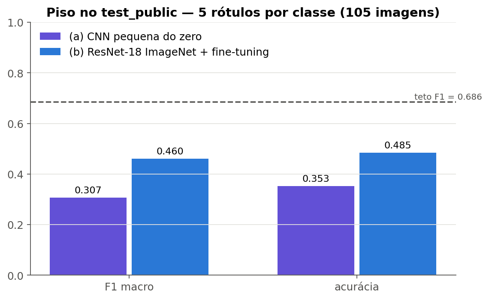

**Em que época começa a decorar?**

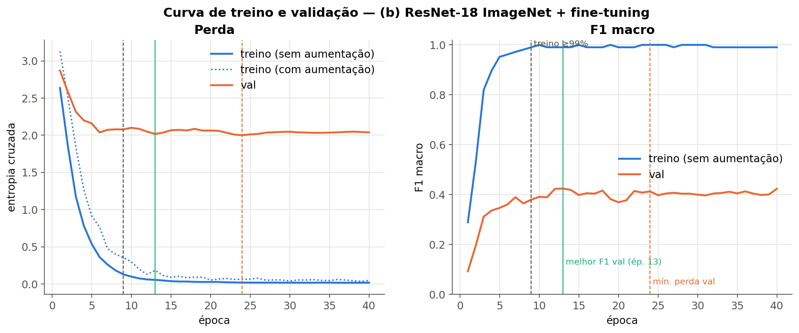

A ResNet-18 acerta ≥99% das 105 imagens de treino (sem aumentação) já na
**época 9**. A partir daí a perda de treino vai a ~0, enquanto o F1 de val fica
num platô de 0,37–0,42 e a perda de val mal se mexe (2,04 na época 6, mínimo
de 2,00 na época 24). A rede decora as 105 imagens em ~9 épocas, e todo
o treino seguinte só aumenta a confiança no treino, sem ganho real no val.

**Matriz de confusão da versão (b).** woodchuck já funciona como sumidouro
no piso (crow→woodchuck: 30), grey_fox vaza para coyote (15) e bobcat
acerta só 3 de 34.

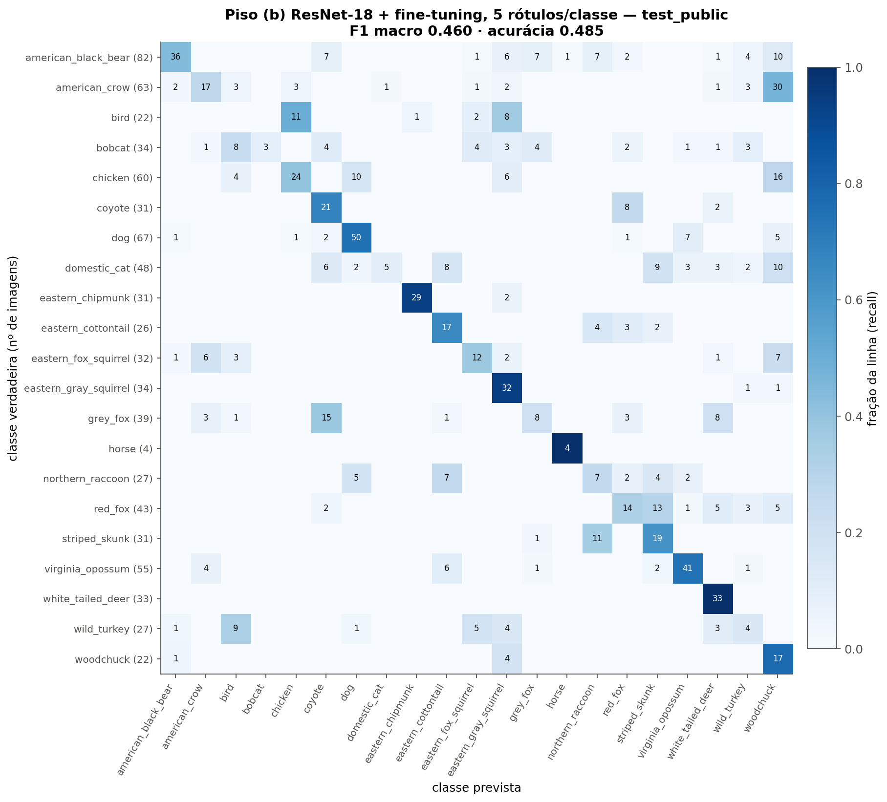

Outras figuras: [curva da CNN do zero](outputs/part0/03b_curva_small_cnn.png),
[F1 por classe](outputs/part0/04_f1_por_classe.png).

## Parte 1 — Trilha C: o professor

**Escolha do professor**, feita **só com os 105 rótulos do orçamento** (que
são do train). O val nunca é mostrado ao professor. O test_public aparece só
como referência.

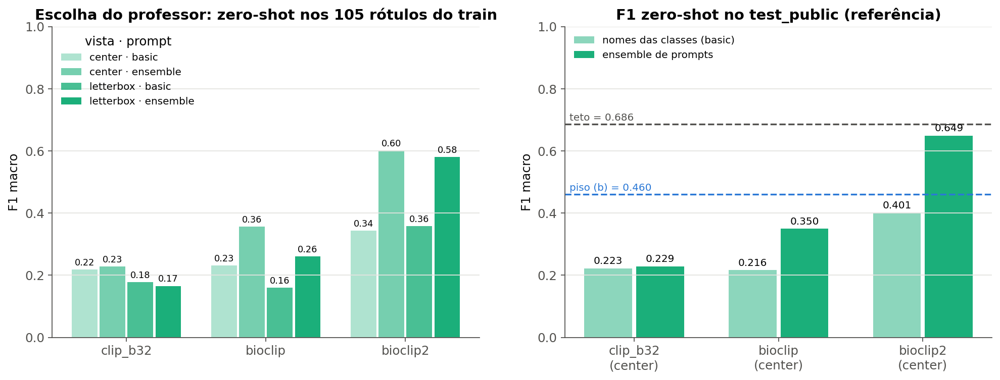

| professor (pesos abertos, rodando local) | F1 nos 105 rótulos (center · ensemble) | F1 zero-shot test_public: só nomes das classes | … ensemble de prompts |
|---|---|---|---|
| CLIP ViT-B/32 (OpenAI) | 0,23 | 0,223 | 0,229 |
| BioCLIP (ViT-B/16) | 0,36 | 0,216 | 0,350 |
| **BioCLIP 2 (ViT-L/14)** | **0,60** | **0,401** | **0,649** |

- A linha de referência obrigatória (nomes das classes como prompt) é **0,401**.
  Com o ensemble de prompts (nome comum + científico, "camera trap photo",
  "at night", "infrared") o mesmo modelo vai a **0,649**, acima do piso (0,460).
- **Center crop venceu letterbox** em todos os professores: a foto inteira com
  faixas cinza deixa o animal ainda menor nos 224 px do ViT.
- **Professor melhorado** com os rótulos do orçamento: protótipo de cada
  classe = `normalize(texto + β · média das imagens rotuladas)`, com β e a
  temperatura escolhidos por leave-one-out nos próprios rótulos.

| orçamento | β (LOO) | professor melhorado, F1 test_public |
|---|---|---|
| 1/classe | 1,0 (padrão: LOO impossível) | 0,671 |
| 5/classe | 0,25 | 0,682 |
| 20/classe | 1,0 | 0,738 |

**Onde o professor erra.** A matriz de confusão do professor zero-shot é a
matriz de ruído dos pseudo-rótulos:

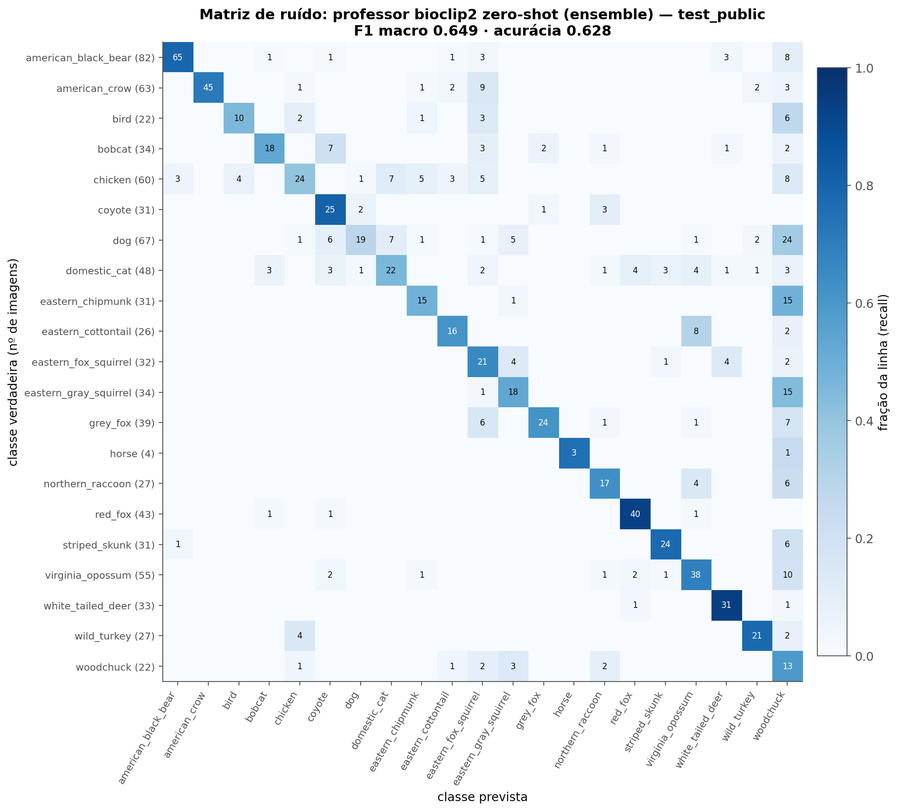

- **Woodchuck é uma classe-ímã.** O professor zero-shot prevê woodchuck 134
  vezes no test_public, onde só há 22 (acerta 13). Essas previsões têm
  confiança média 0,44 (contra 0,67 nas demais), e o texto "woodchuck" é o
  mais próximo do centróide de todas as imagens. Imagem com pouca evidência
  (animal pequeno, borrado) cai na classe mais "genérica". Os maiores
  vazamentos: dog→woodchuck (24), chipmunk→woodchuck (15), gray
  squirrel→woodchuck (15). O professor melhorado reduz os pseudo-rótulos de
  woodchuck no train de 835 para ~320:

  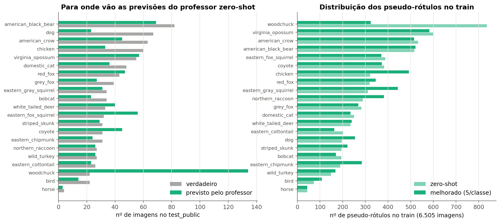
- **Noite não é o problema, é o contrário.**
  48% do test_public é noturno em IR (detectado pela diferença entre canais
  RGB, com separação limpa). O professor acerta 0,73 à noite e 0,54 de dia.
  Parte disso é a mistura de espécies (as diurnas, como passarinhos, esquilos
  e galinha, são mais difíceis), mas o efeito se mantém **dentro da mesma
  classe**: grey_fox 0,00→0,71, bird 0,27→0,86, dog 0,23→0,55. A exceção é
  domestic_cat (0,71→0,32). Hipótese: o flash IR ilumina o animal próximo e
  apaga o fundo. O piso não tem essa vantagem (0,49 dia, 0,48 noite).

  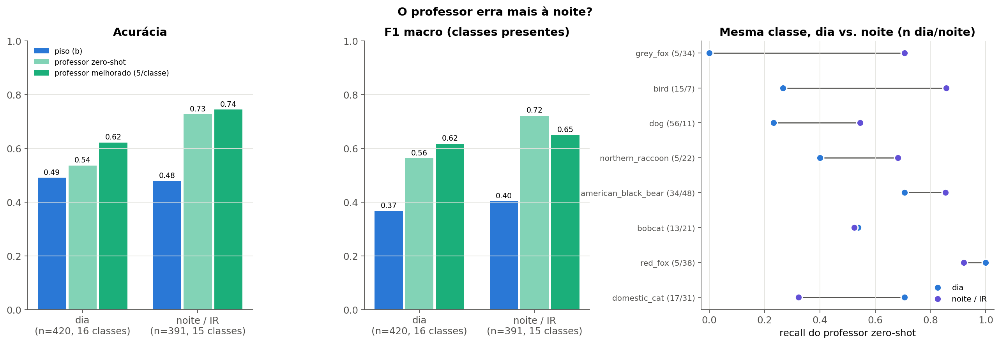
- **Classes parecidas:** crow→fox_squirrel (9), cottontail→opossum (8),
  bobcat→coyote (7). bird↔american_crow quase não se confundem no professor
  (0 e 0).
- **Precisão × cobertura** (diagnóstico no test_public, não seleção): com
  τ=0,8 os pseudo-rótulos do professor melhorado têm ~98% de precisão em ~45%
  das imagens. Com τ=0,5, ~88% em ~67%.

  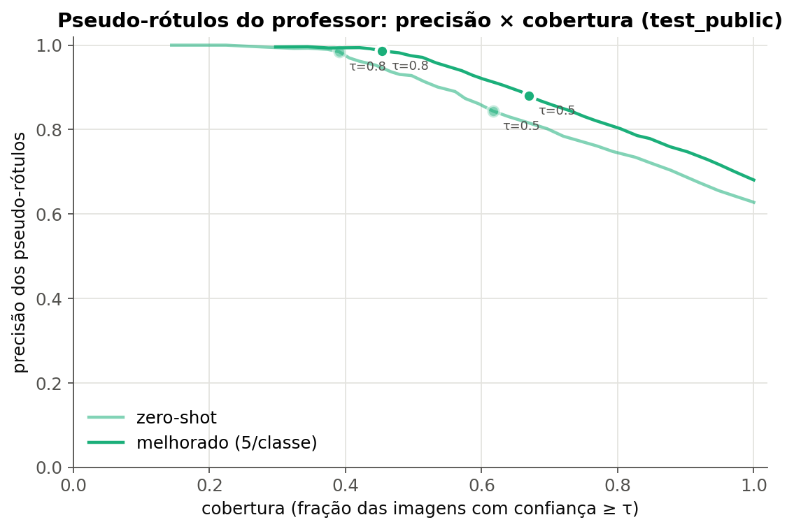

  Outra figura: [matriz de ruído do professor melhorado](outputs/part1/03_matriz_ruido_teacher_improved_b5.png).

## Parte 1 — Trilha C: o aluno

O aluno é uma ResNet-18 ImageNet treinada em **todo o train** (6.505 imagens)
com os pseudo-rótulos do professor, mais os 105 rótulos verdadeiros com peso 5.
Seis formas de tratar o ruído, todas com a mesma receita (12 épocas, época
escolhida no val), seed 0, orçamento 5:

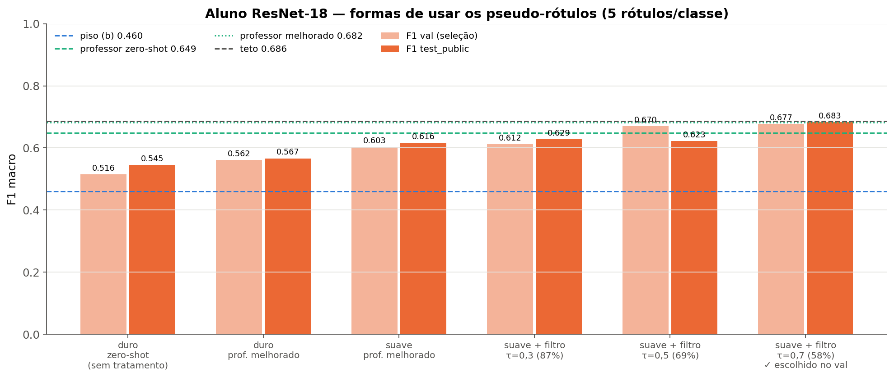

| variante | imagens usadas | F1 val | F1 test | acurácia test |
|---|---|---|---|---|
| duro, professor zero-shot (sem tratamento) | 6.505 | 0,516 | 0,545 | 0,565 |
| duro, professor melhorado | 6.505 | 0,562 | 0,567 | 0,587 |
| suave (distribuição do professor) | 6.505 | 0,603 | 0,616 | 0,656 |
| suave + filtro τ=0,3 | 5.640 | 0,612 | 0,629 | 0,673 |
| suave + filtro τ=0,5 | 4.483 | 0,670 | 0,623 | 0,647 |
| **suave + filtro τ=0,7** (escolhido no val) | 3.745 | **0,677** | **0,683** | **0,736** |

Cada tratamento do ruído soma ganho: professor melhorado (+0,02), rótulo
suave em vez de argmax (+0,05), descartar os 42% menos confiáveis (+0,07).
Jogar fora metade dos dados ajudou, porque os pseudo-rótulos de baixa
confiança são justamente os errados (`06_precisao_cobertura.png`).

**Resultado: o aluno empata com o professor no F1 (0,683 vs. 0,682) e o
supera em acurácia (0,736 vs. 0,681)**, com menos de 1/25 dos parâmetros
do encoder de imagem do BioCLIP 2 (ViT-L/14, ~300M) e rodando em CPU. Fica
a 0,003 do teto (0,686), que usa todos os rótulos do train.

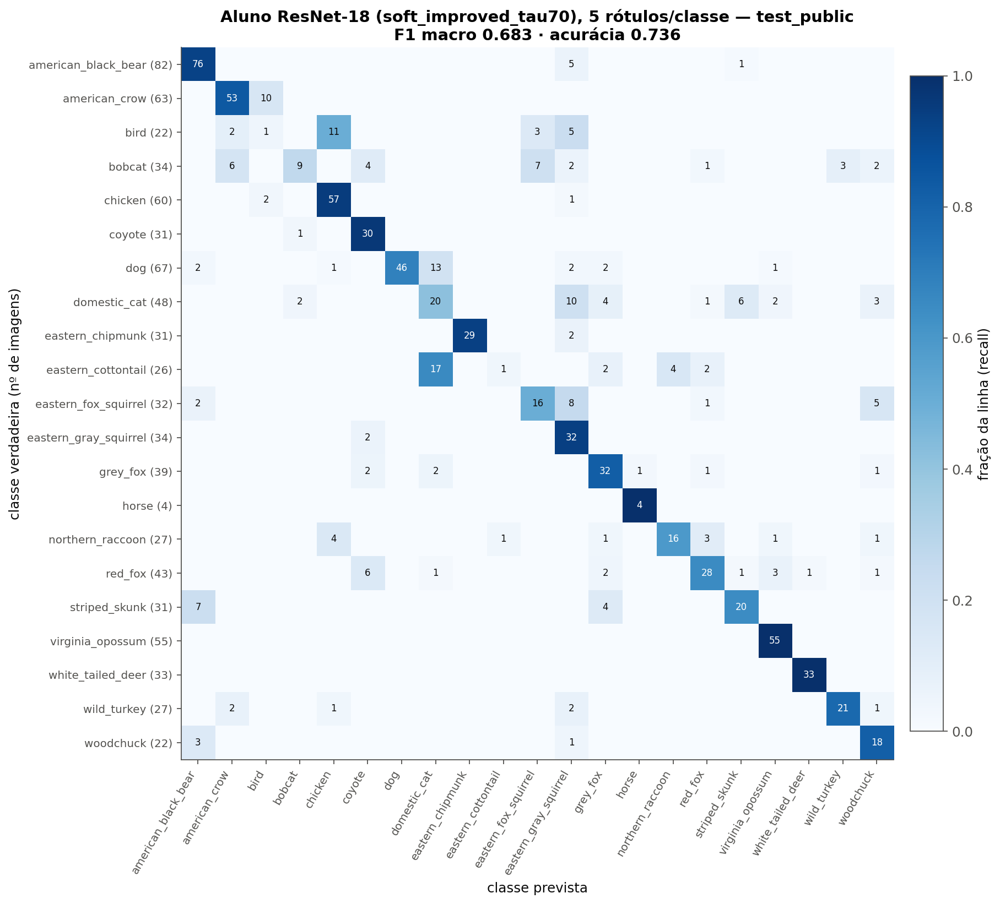

### Onde o aluno supera o professor, e por quê

O aluno ganha em dog (+0,40), chicken (+0,30), opossum (+0,24), woodchuck
(+0,23), deer (+0,18) e chipmunk (+0,17):

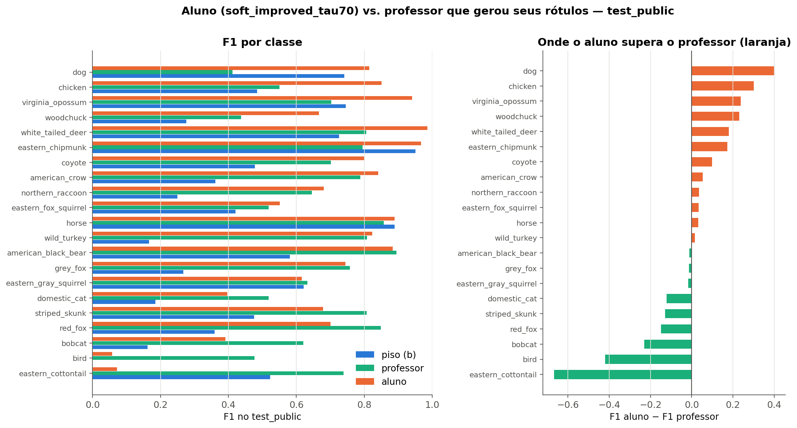

Três razões, medidas com as caixas do MegaDetector:

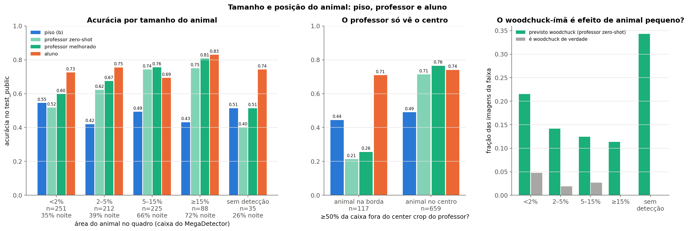


1. **Ele vê o quadro inteiro.** O professor (ViT) recebe só o quadrado
   central da foto e perde 12,5% de cada lateral. Usando as caixas do
   MegaDetector, 117 imagens do teste (15%) têm mais da metade do animal fora
   desse quadrado. **Nelas o professor acerta 21–26% e o aluno, 71%.** No
   centro, os dois empatam (0,76 vs. 0,74). A entrada 224×320 sem crop foi
   decidida na Parte 0 por esse motivo, e aqui ela rende.
2. **Ele herda a parte limpa do professor, não os vícios.** O woodchuck-ímã
   não passa para o aluno. O professor zero-shot prevê woodchuck 134 vezes e
   o melhorado 65; o aluno, 32 (são 22 de verdade). Essas previsões do
   professor têm baixa confiança, então o filtro τ=0,7 as descarta, e o aluno
   aprende woodchuck só com os exemplos claros. Por isso dog e chipmunk, que
   vazavam para woodchuck, sobem.
3. **Ele aprende a cena.** Câmeras trap são fixas, e o aluno, treinado em
   6,5 mil fotos dessas mesmas câmeras, usa o contexto. Com animal minúsculo
   (<2% do quadro, 31% das imagens), o professor acerta 0,52 e o aluno, 0,73.
   Quando o MegaDetector **não encontra animal nenhum** (35 imagens), o aluno
   ainda acerta 74%, contra 40% do professor zero-shot. Só a cena explica isso.

### Onde ele perde: o mesmo atalho, do outro lado

O aluno perde para o professor em eastern_cottontail (−0,67), bird (−0,42) e
bobcat (−0,23). **O coelho é o caso mais claro de atalho de câmera**
(`scripts/part1_cottontail.py`):

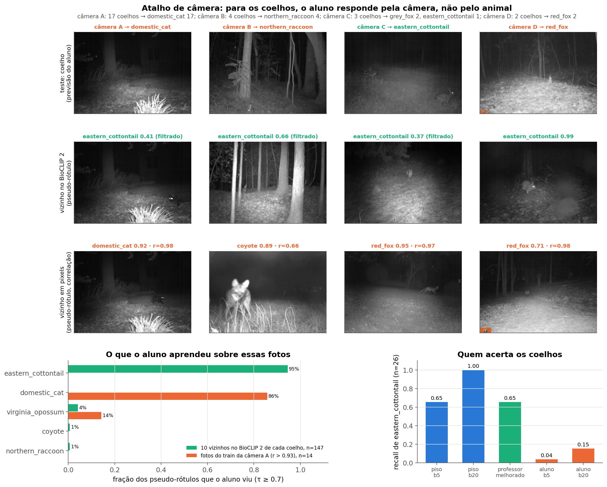

- Os 26 coelhos do test_public são todos noturnos e vêm de **4 câmeras**
  (agrupadas pela correlação dos pixels, que mede o fundo). O aluno acerta 1.
- **Dentro de cada câmera, a resposta é quase sempre a mesma**:
  - câmera A: 17 coelhos, **os 17 viram gato**;
  - câmera B: 4 coelhos, **os 4 viram guaxinim**;
  - câmera C: 2 viram raposa-cinzenta e 1 é acertado;
  - câmera D: os 2 viram raposa-vermelha.
- **Os pseudo-rótulos dos coelhos não são o problema.** No espaço do BioCLIP
  2, os 10 vizinhos de cada coelho do teste no train são coelhos: dos que o
  aluno viu (filtro τ=0,7), 139 de 147.
- **O problema é o que o aluno viu de cada câmera.** A câmera A aparece 23
  vezes no train (correlação de pixels > 0,93), e nenhuma dessas fotos é de
  coelho: das que passaram no filtro, 12 são gato e 2, gambá-de-cauda-preênsil.
  Na câmera C, 108 das 169 fotos vistas são raposa-cinzenta, e a resposta do
  aluno é raposa-cinzenta. A câmera B não aparece no train por essa medida, então
  o "guaxinim" dela fica sem explicação aqui.
- O coelho da câmera A tem cerca de 16×15 px. Para uma CNN, "esta câmera à
  noite" pesa mais que essa mancha. É o mesmo hábito que dá ao aluno os 74% de
  acerto quando o MegaDetector nem encontra o animal.
- O piso b20 acerta os 26, **mas não por conhecer a câmera**: nenhum dos seus
  420 rótulos é dessas câmeras. Ele prevê coelho 66 vezes no teste, com 40
  erros, e por isso o F1 dele no coelho fica em 0,57.

O BioCLIP olha para o animal; o aluno olha para a foto. Isso ajuda em 15%
do teste (animal na borda, animal minúsculo) e quebra quando uma câmera
recebe um animal que ela "não costuma ter". O mesmo coelho reaparece como
erro na Parte 3.

**Dia e noite:** de dia o aluno supera o professor (acurácia 0,745 vs.
0,621). À noite fica um pouco abaixo (0,726 vs. 0,744), e o coelho noturno
responde por boa parte dessa diferença.

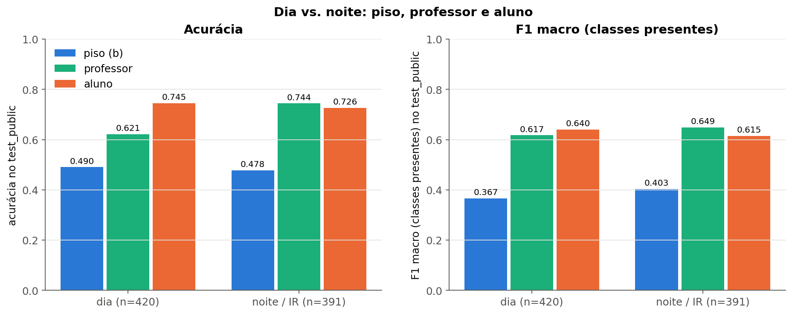

**Pergunta da apresentação: e se aparecer uma capivara?** O aluno tem 21
saídas e vai sempre escolher uma delas. Três sinais para detectar o
fora-de-distribuição, todos sem rótulo:

- **Confiança baixa do aluno:** softmax máximo ou energia. Como o aluno erra
  com confiança alta em cenas conhecidas (o coelho), esse sinal sozinho não
  basta.
- **Discordância professor × aluno.**
- **Distância do embedding do BioCLIP ao protótipo mais próximo.**

O BioCLIP 2 é de vocabulário aberto, então basta acrescentar o texto
"capybara" ao classificador do professor, sem treino, para nomear a classe nova
e gerar pseudo-rótulos para ela.

## Parte 2 — Curva de orçamento

Mesma receita do piso (b) e do aluno escolhido (`soft_improved_tau70`) com 1,
5 e 20 rótulos por classe. No orçamento 5 foram 3 seeds; a seed muda a
inicialização da cabeça, a ordem dos lotes e a aumentação, e os rótulos são
os mesmos. Números em `curva_orcamento.csv`.

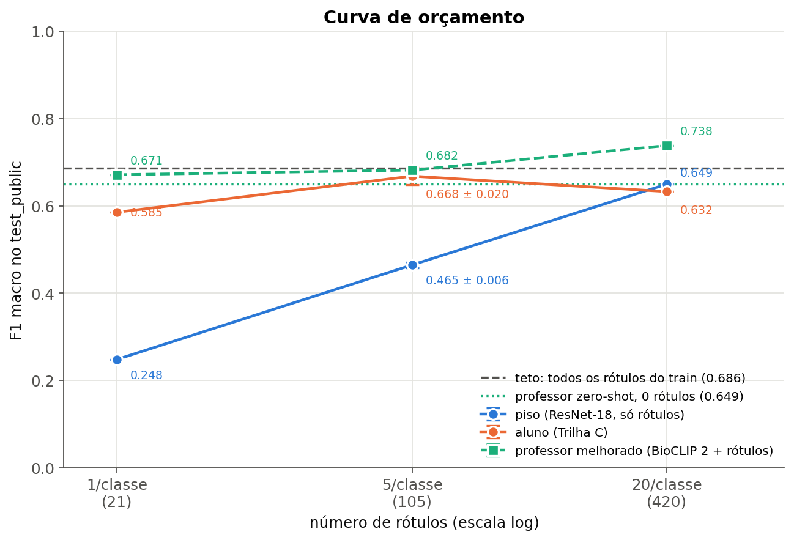

| método | 1/classe | 5/classe (3 seeds) | 20/classe |
|---|---|---|---|
| piso (ResNet-18, só rótulos) | 0,248 | 0,465 ± 0,006 | 0,649 |
| **aluno (Trilha C)** | **0,585** | **0,668 ± 0,020** | 0,632 |
| professor melhorado (referência) | 0,671 | 0,682 | 0,738 |
| professor zero-shot (0 rótulos) | 0,649 | 0,649 | 0,649 |
| teto (todos os rótulos) | | 0,686 | |

- **Com 1 rótulo por classe, o aluno (0,585) faz mais que o piso com 5
  (0,465).** Os dados sem rótulo valem mais que 4 rótulos por classe.
- **Com 5, o aluno ganha +0,20 do piso** (3 seeds; desvio de 0,02 contra uma
  diferença de 0,20) e fica perto do teto.
- **Com 20, o piso alcança o aluno** (0,649 vs. 0,632). Dois motivos:
  - O coelho: o aluno b20 continua preso ao atalho de câmera (F1 0,18),
    enquanto o piso b20 prevê coelho em excesso e acerta os 26 (F1 0,57).
  - O aluno b20 é **uma seed só, e o val escolheu a época 2.** O F1 de val
    teve um pico isolado em 0,630 na época 2, caiu para 0,448 na época 3 e
    voltou a ~0,60 no fim. Com 202 imagens de val, um pico assim é ruído, e
    o modelo escolhido estava subtreinado.

  Não refizemos a seleção olhando o teste. Registramos como limitação: com
  20 rótulos, uma seleção de época mais estável (por exemplo, média móvel do
  F1 de val, ou a época final) seria a primeira coisa a testar.
- **O professor melhorado continua acima do aluno com 20 rótulos (0,738).**
  Destilar para uma ResNet-18 custa ~0,1 de F1 nesse ponto. É a mesma troca
  da Parte 1: o aluno ganha nas bordas e nos animais pequenos e perde nas
  cenas em que o fundo engana.

**Ganho por classe com 5 rótulos** (média de 3 seeds):

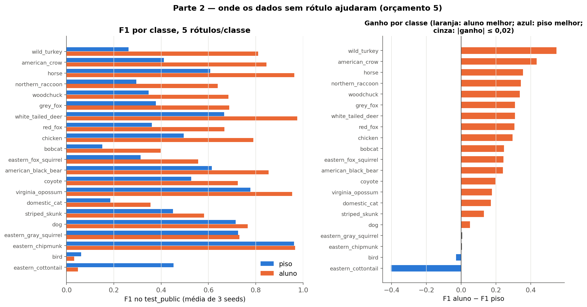

O aluno ganha em 17 das 21 classes. Os maiores ganhos estão nas
classes que o piso mal reconhecia: wild_turkey (+0,55), american_crow
(+0,43), horse (+0,36), raccoon (+0,34), woodchuck (+0,34). Há uma perda
grande: eastern_cottontail (−0,40), o atalho de câmera descrito acima. bird fica
perto de zero nos dois (passarinhos minúsculos, 22 no teste).

## Parte 3 — Erros e acertos com mapas de saliência

Modelo final no test_public. Dois mapas por imagem: **Grad-CAM** na `layer4`
(grosso, 7×10 células de 32 px) e **oclusão** (quadrado de 32 px tapado com
passo 16; mede quanto a probabilidade cai). A caixa verde é do MegaDetector,
usada só para medir quanto da saliência cai no animal. As 8 imagens foram
escolhidas **por regras fixadas antes de olhar** (`scripts/part3_gallery.py`),
não a dedo:

- erro mais confiante;
- erro com o menor animal;
- erro com animal ≥3% do quadro e a menor atenção no animal;
- para os acertos, os 3 mais focados no animal e os 2 menos focados, de
  classes diferentes e com animal ≥2%.

### Três erros

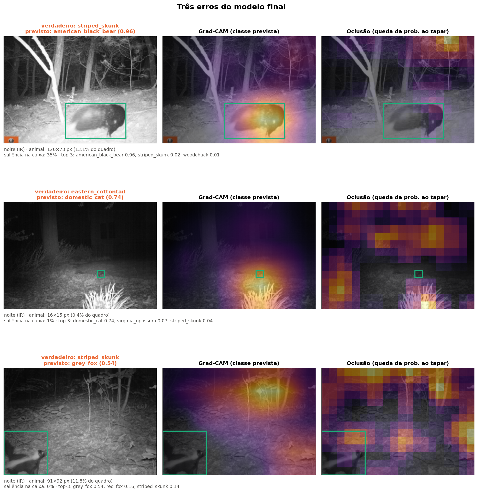

| # | verdadeiro → previsto | o que os mapas mostram | diagnóstico |
|---|---|---|---|
| E1 | striped_skunk → american_black_bear (0,96) | Grad-CAM **no animal** (35% da saliência numa caixa de 13% do quadro). A oclusão concentra-se na cabeça. | **Olhou o lugar certo e leu o traço errado.** O gambá passa rápido e o borrão de movimento apaga a listra branca. Sobra uma massa escura e volumosa à noite, que é o que define "urso" no treino. Aumentação com borrão de movimento ou mais gambás noturnos atacariam isso. |
| E2 | eastern_cottontail → domestic_cat (0,74) | Coelho de 16×15 px (0,4% do quadro). Grad-CAM no tufo de capim; **1% da saliência no animal**. A oclusão espalha-se pelo fundo. | **Atalho de câmera**, o mesmo da Parte 1. É a câmera A: no train ela só aparece com gatos e gambás-de-cauda-preênsil, e o modelo reconhece o lugar, não o bicho. Tapar o coelho não muda nada. |
| E3 | striped_skunk → grey_fox (0,54) | Gambá grande e nítido, mas **cortado no canto** inferior esquerdo. Grad-CAM **0%** na caixa, concentrado no meio da cena. | **Nem olhou para o animal.** Um animal entrando pela borda é raro no treino, e o modelo decidiu pelo cenário, com baixa confiança (0,54; o gambá aparece em 3º, 0,14). |

### Cinco acertos

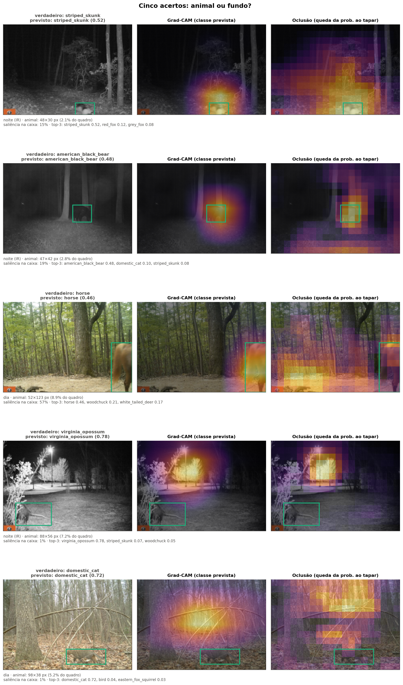

| # | classe | atenção no animal | leitura |
|---|---|---|---|
| A1 | striped_skunk (0,52) | 15% numa caixa de 2,1% (7× o acaso). Os dois mapas centrados no gambá. | Certo pelo motivo certo, mesmo com animal pequeno e na borda. |
| A2 | american_black_bear (0,48) | 19% numa caixa de 2,8%. A oclusão é máxima sobre o urso. | Certo pelo motivo certo. |
| A3 | horse (0,46) | 57% numa caixa de 8,9%. | O cavalo está **cortado na borda direita**: exatamente o que o center crop do professor perderia. A oclusão também marca o chão, ou seja, parte da decisão vem da cena. |
| A4 | virginia_opossum (0,78) | **1%**. Grad-CAM e oclusão sobre o **poste de luz e as árvores iluminadas**. | **Certo pelo motivo errado.** Esta câmera, de um estacionamento à noite, é "terra de gambá-de-cauda-preênsil" no treino. Tapar o animal não muda a resposta; tapar o poste, sim. |
| A5 | domestic_cat (0,72) | **1%**. Atenção nos galhos do alto. | Mesmo caso: acerto pela cena. Em outra câmera, o mesmo gato provavelmente não seria reconhecido. |

### Olha para o animal ou para o fundo? (agregado, 776 imagens com caixa)

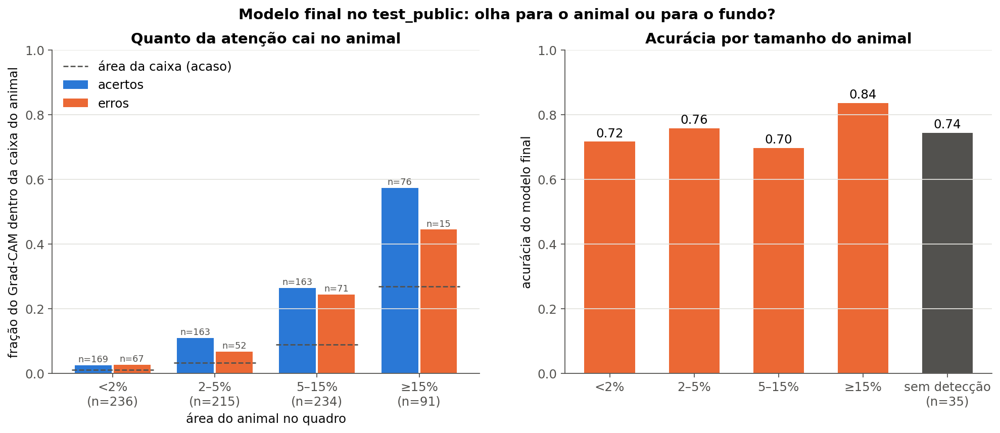

A pergunta tem resposta quantitativa: a
fração do Grad-CAM dentro da caixa, comparada com a área da caixa (o que
daria uma atenção uniforme).

| área do animal | atenção no animal (acertos) | (erros) | área da caixa (acaso) | pico do mapa no animal (acertos / erros) |
|---|---|---|---|---|
| <2% | 2,5% | 2,7% | ~1% | 9% / 7% |
| 2–5% | 11% | 7% | ~3% | 45% / 15% |
| 5–15% | 26% | 24% | ~9% | 79% / 54% |
| ≥15% | 57% | 44% | ~27% | 91% / 47% |

- **Animal grande: o modelo olha para o animal.** A atenção fica em 2–3× o
  acaso, e o pico do mapa cai no animal em 79–91% dos acertos.
- **Animal pequeno: olha para o fundo.** Abaixo de 2% do quadro (30% das
  imagens), a atenção no animal é praticamente o acaso, e o pico só cai nele
  em 9% dos casos. **Mesmo assim, o modelo acerta 72% dessas imagens**: a
  decisão vem da cena.
- **Em todas as faixas, acertos olham mais para o animal que erros.** No
  pointing game: 50% contra 28% no geral.

**Conclusão.** Com animal visível, o modelo aprendeu o animal. Com animal
pequeno, ele aprendeu *qual câmera costuma ter qual bicho*. É esse hábito que
o faz superar o professor (Parte 1: animal minúsculo, nenhuma detecção) e
falhar em bloco quando uma câmera recebe um visitante raro (o coelho). Num
test_private com as mesmas câmeras, isso ajuda; com câmeras novas, o desempenho
nos animais pequenos deve cair bastante. Seria a primeira coisa a medir com
mais tempo, por exemplo agrupando por câmera.
